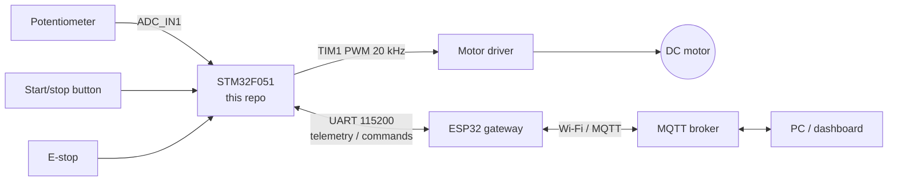
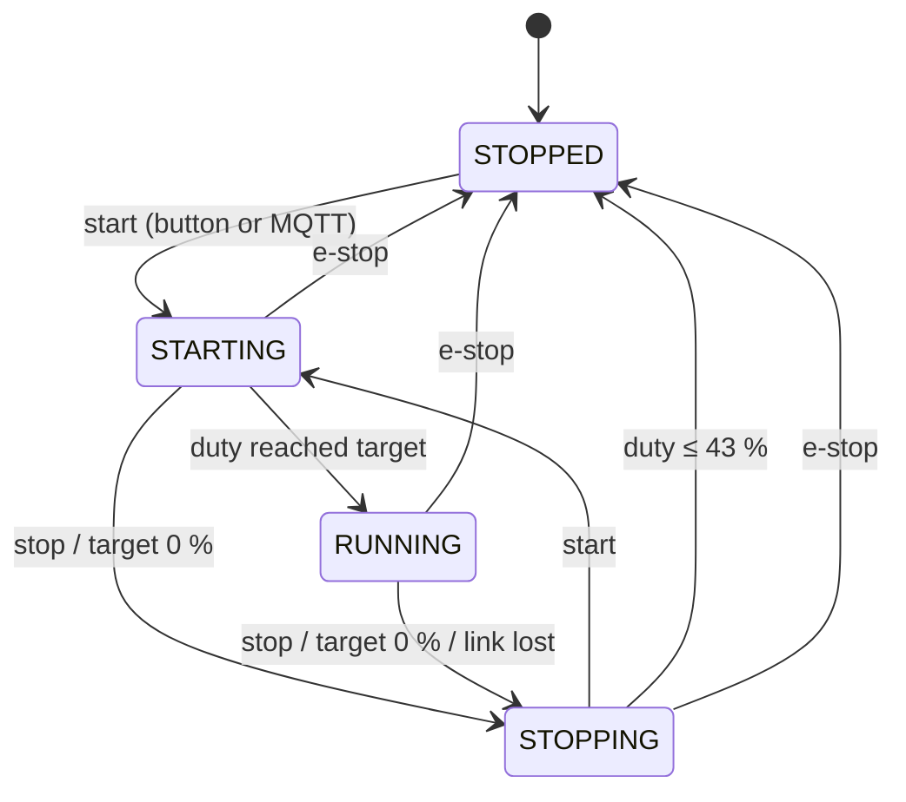

# Motor Control Firmware – STM32F051

[](https://github.com/emirkls44/industrial_motor_control_stm32/actions/workflows/ci.yml)

Firmware for a PWM-driven DC motor on an STM32F0DISCOVERY board. The motor is controlled
locally with a start/stop button and a potentiometer, or remotely over MQTT through the
[ESP32 gateway](https://github.com/emirkls44/industrial-motor-control-esp32-gateway).
Telemetry is sent every 250 ms over a CRC-checked serial protocol.



## Features

- Soft start and soft stop (40 %/s ramp) with a measured minimum running duty
- Emergency stop input that cuts the PWM output on the first sample
- Local control (button + potentiometer) and remote control (MQTT `START`, `STOP`, `DUTY n`)
- Link supervision: a remotely started motor stops if the gateway goes silent for 2 s
- Independent watchdog; any fault handler forces the PWM output low before the reset
- Framed binary protocol with CRC-8, sequence numbers and a resynchronising parser
- Host unit tests for the protocol and the motor state machine, run in CI with ASan/UBSan
- Command-line CMake build next to the STM32CubeIDE project

## Hardware

| Signal          | Pin  | Peripheral | Notes                                       |
|-----------------|------|------------|---------------------------------------------|
| Start/stop      | PA0  | GPIO in    | User button on the Discovery board, active high, 30 ms debounce |
| Potentiometer   | PA1  | ADC_IN1    | 12-bit, calibrated, 8× averaged             |
| E-stop          | PA3  | GPIO in    | Internal pull-up, see [Safety](#safety)     |
| Motor PWM       | PA8  | TIM1_CH1   | 20 kHz, 1 % resolution                      |
| UART TX / RX    | PA9 / PA10 | USART1 | 115200 8N1, to the ESP32 (cross TX/RX, common GND) |

System clock: 48 MHz (HSI/2 × 12 PLL).

## Control behaviour



**Design decisions and numbers**

| Item | Value | Why |
|---|---|---|
| PWM frequency | 20 kHz (48 MHz / 2400) | Above the audible range, still 1 % duty resolution |
| Minimum duty | 43 % | Measured on the bench: below this the motor does not turn. Requests below it mean 0 % |
| Ramp | 2 % every 50 ms | Limits inrush current; 43 → 100 % takes ~1.4 s |
| Start | jumps to 43 %, then ramps | Ramping from 0 % would keep the motor stalled for ~1 s |
| Stop | ramps down to 43 %, then cuts | Same reason, in reverse |
| Target 0 % while running | soft stop, stays stopped | Turning the pot back up must not restart the motor without a start command |
| ADC sampling time | 239.5 cycles | CubeMX's 1.5 cycles is too short for a potentiometer's source impedance |
| Telemetry period | 250 ms | |
| Link timeout | 2 s | The gateway sends a heartbeat every 500 ms |
| Watchdog | ~500 ms (IWDG, LSI) | Frozen while the debugger halts the core |

**Local vs. remote control**

- Pressing the start/stop button always takes control back to local mode (potentiometer sets the duty).
- An MQTT `START` or `DUTY n` switches to remote mode. In remote mode the duty comes from the last
  `DUTY n` command, or from the potentiometer if none was received.
- An MQTT `STOP` is accepted in any mode.
- In remote mode the motor is stopped if no valid frame arrives for 2 s, and the `LINK_LOST` flag is
  reported until the next start.
- While the e-stop is active every button press and remote command is discarded, so releasing it
  never starts the motor by itself.

## Serial protocol (v2)

Defined in [`Core/Inc/protocol.h`](Core/Inc/protocol.h). The same file is used by the ESP32 gateway.

```
+------+------+---------+------+-----+-----+--------------+------+
| 0xAA | 0x55 | VERSION | TYPE | LEN | SEQ | PAYLOAD[LEN] | CRC8 |
+------+------+---------+------+-----+-----+--------------+------+
CRC-8/SMBUS (poly 0x07, init 0x00) over VERSION..PAYLOAD
```

| Type | Direction | Payload |
|---|---|---|
| `0x01` telemetry | STM32 → ESP32 | `state, command_duty, target_duty, current_duty, flags, adc_lo, adc_hi` |
| `0x02` command | ESP32 → STM32 | `command, value` — `1` START, `2` STOP, `3` SET_DUTY (0–100), `4` HEARTBEAT |

Telemetry flags: bit 0 e-stop active, bit 1 remote control, bit 2 stopped by link loss,
bit 3 last reset caused by the watchdog.

Version 2 added a sequence byte to command frames and replaced the telemetry `estop` byte with
`flags`. Version 1 frames are rejected by the parser.

## Safety

This is a lab project, not a certified safety system.

- **The e-stop is read by software.** A real emergency stop must also remove power in hardware
  (driver enable line or contactor), independent of the MCU. TIM1's break input (`TIM1_BKIN`, PB12)
  can additionally disable the PWM output in hardware within one clock cycle.
- **Use a normally-closed e-stop contact.** With the current normally-open wiring a broken wire reads
  as "not pressed". Wire the e-stop as normally closed between PA3 and GND and build with
  `ESTOP_CONTACT_NORMALLY_CLOSED=1` so that a broken wire stops the motor.
- The MQTT command topic has no authentication by default. See the gateway README.

## Project structure

```
Core/
  Inc/, Src/
    app.c               application layer: wiring, control rules, HAL callbacks
    motor_control.c     state machine, ramps, minimum duty
    motor_driver.c      0..100 % duty -> TIM1 compare value
    analog_input.c      ADC calibration, averaging, hysteresis
    button.c            polled debounced buttons
    command_receiver.c  UART interrupt reception + protocol parser
    communication.c     periodic telemetry
    protocol.c          frame encoder/decoder, CRC-8 (no HAL dependency)
    watchdog.c          IWDG
    main.c, stm32f0xx_*.c  generated by STM32CubeMX
tests/                  host unit tests (protocol, motor state machine)
cmake/                  arm-none-eabi toolchain file
```

`main.c` only calls `App_Init()` and `App_Update()` from its `USER CODE` sections, so regenerating the
code in CubeMX does not touch the application.

## Building

**STM32CubeIDE:** *File → Import → Existing Projects into Workspace*, select this folder, build.

**Command line:**

```sh
cmake -S . -B build -DCMAKE_TOOLCHAIN_FILE=cmake/arm-none-eabi.cmake -DCMAKE_BUILD_TYPE=Release
cmake --build build
# flash, e.g. with STM32CubeProgrammer:
STM32_Programmer_CLI -c port=SWD -w build/industrial_motor_control_stm32.hex -v -rst
```

**Unit tests** (any PC with a C compiler):

```sh
make -C tests
```

## Known limitations

- Open-loop duty control: there is no speed or current feedback.
- Telemetry is sent with a blocking `HAL_UART_Transmit` (~1.2 ms every 250 ms); DMA would remove that.
- Only the most recent remote command is kept if two arrive within one main-loop iteration.
